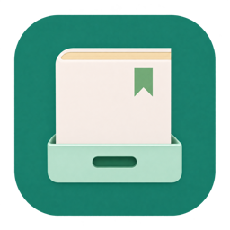
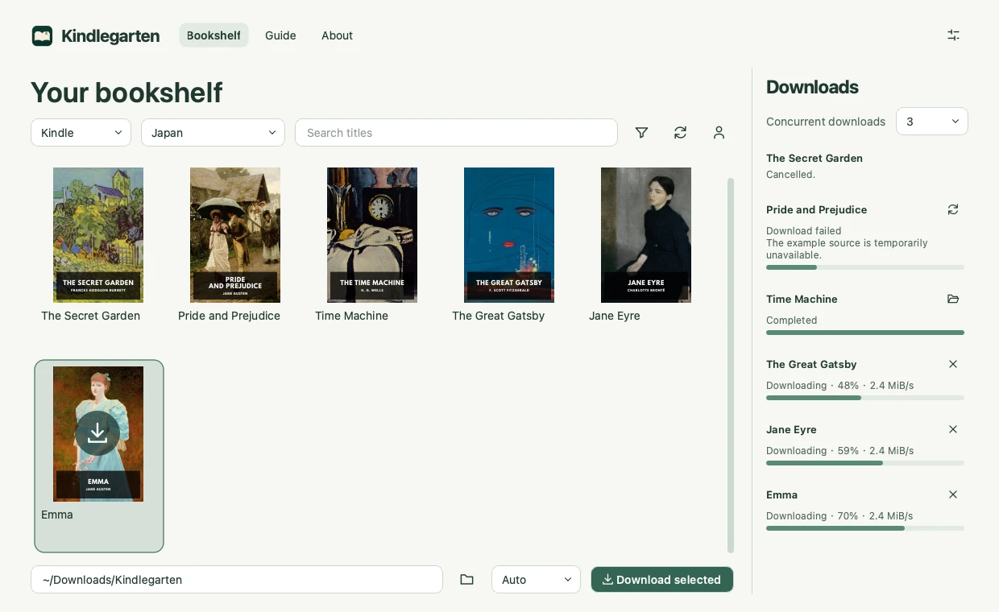

<p align="center">
  
</p>

<h1 align="center">Kindlegarten</h1>

<p align="center"><strong>A desktop app and CLI for backing up your purchased ebooks and comics.</strong></p>

<p align="center">
  <a href="https://github.com/yinyanfr/kindlegarten/releases"></a>
  <a href="https://pypi.org/project/kindlegarten/"></a>
  <a href="https://github.com/yinyanfr/kindlegarten/blob/main/DESKTOP_BUILD.md"></a>
  <a href="#desktop-app"></a>
  <a href="https://github.com/yinyanfr/kindlegarten/actions/workflows/publish.yml"></a>
  <a href="https://github.com/yinyanfr/kindlegarten/blob/main/LICENSE"></a>
</p>

<p align="center">
  <a href="https://github.com/yinyanfr/kindlegarten/blob/main/QUICKSTART.md">CLI quick start</a> ·
  <a href="#installation">Installation</a> ·
  <a href="https://github.com/yinyanfr/kindlegarten/blob/main/CHANGELOG.md">Changelog</a> ·
  <a href="https://github.com/yinyanfr/kindlegarten/blob/main/README.zh-CN.md">简体中文</a>
</p>

> [!TIP]
> **Scope of use**
>
> Use this project only to back up Kindle books you have legally purchased from Amazon and books or comics you have legally purchased from Comipo or DLsite.

Back up purchased Kindle books and titles available through DLsite Play, including supported Comipo purchases. For Kindle, Kindlegarten downloads the iPad edition and preserves the color illustrations Amazon supplies for that edition.

- Automatically exports text-based books as EPUB and fixed-layout comics and magazines as CBZ when their pages can be extracted as images.
- Names output files after the book title, replaces characters disallowed in filenames, and shortens long titles. The CLI tracks the entire download with one progress bar.
- Keeps a separate local sign-in for each Kindle store.

A series download exports the purchased volumes in volume order to a folder named after the series.

## Desktop app

<p align="center">
  <picture>
    <source media="(prefers-color-scheme: dark)" srcset="https://raw.githubusercontent.com/yinyanfr/kindlegarten/main/docs/media/bookshelf-en-dark.webp">
    
  </picture>
  <br>
  <sub>Sample bookshelf with covers from <a href="https://standardebooks.org/ebooks">Standard Ebooks</a>.</sub>
</p>

Download the macOS Apple Silicon app, Windows x64 portable ZIP or Linux x86_64 AppImage from [GitHub Releases](https://github.com/yinyanfr/kindlegarten/releases). You can also install and launch the desktop app from Python.

```sh
python -m pip install 'kindlegarten[gui]'
kindlegarten-gui
```

See the [desktop build guide](https://github.com/yinyanfr/kindlegarten/blob/main/DESKTOP_BUILD.md) for platform requirements and source builds. Converting Kindle files uses your installed Calibre.

Choose **Kindle** or **DLsite** in the bookshelf. Kindle also has a store selector. The **Sign in** button in the bookshelf and the account icon open settings for that account. You can sign in, reauthorize, paste credentials, or sign out.

The bookshelf opens from its local cache and checks for changes in the background. Use the filter icon beside search to sort books and series together by title or purchase date. Purchase date defaults to newest first and uses the latest purchased volume for a series.

### Queue and manage downloads

Choose a destination folder and format. Hover over a cover and click the center icon to download a book or open a series. Right-click a card for the download and store page actions, plus **Open** for a series. Click elsewhere on a card to select it. Hold Command on macOS or Ctrl on Windows and Linux to add individual cards, or hold Shift to select a range. Click **Download selected** to queue the selection. The download controls spin while tasks are being added.

The **Downloads** panel opens on the right when tasks are queued. The download icon at the top right toggles it. Use the plus button to select a source or Kindle store and paste one book or series ID per line. If an ID matches both a book and a series, prefix it with `work:` or `series:`. The panel shows progress and transfer speed when available. The menu at the top sets how many tasks can run at once, from 1 to 10, with a default of 3.

- **Cross** cancels a queued or active task. Files already saved stay in the destination.
- **Circular arrows** retry a failed task with the original destination and format. The task goes to the end of the queue. Series retries skip volumes already saved in the requested format.
- **Folder** opens the output folder after the task finishes.

Individual volumes and whole series go into the same series folder. A check mark on a cover means the book or every purchased volume in a series is saved. A number shows a partially saved series. The app checks the selected destination and counts series volumes only inside their series folder. Files copied from another device can be matched by book ID or by an unambiguous standard filename.

### Settings

Open Settings with the gear in the top right. The sidebar has **General**, **Accounts**, **Downloads**, **Network**, **Guide**, and **About & updates**. General switches between English, Simplified Chinese and Japanese, and between light, dark and system appearance. Accounts manages each Kindle store and the DLsite account. Use the back arrow to return to the current bookshelf and selection.

Under **Downloads**, leave the Calibre path blank to use `KINDLE_CALIBRE_BIN` or automatic detection. You can dismiss the startup reminder and re-enable it here. **Remove Kindle DRM** is on by default. Turn it off to save the original Kindle KFX archive without Calibre.

## CLI library and formats

```sh
kindlegarten help
kindlegarten help series
kindlegarten library
kindlegarten library --source dlsite
kindlegarten library --source amazon --region us
kindlegarten series SERIES_ID --source amazon --region jp --format epub --output ./books
kindlegarten work BJ123456 --source dlsite --format pdf
```

`library` groups purchased books by verified series and displays series and book IDs. It defaults to Kindle Japan. `work` and `series` default to DLsite. Use `--source amazon` for Kindle. The old `--source comipo` option is an alias for `dlsite`.

The desktop app and `download`, `work` and `series` share the same export formats.

| Content | Auto | Available formats |
| --- | --- | --- |
| Text ebook | EPUB | EPUB or PDF using Calibre |
| Image-only comic or magazine | CBZ | CBZ, ZIP, fixed-layout EPUB or PDF |
| Book supplied only as PDF | PDF | PDF |

Pass `--format auto|epub|pdf|cbz|zip` to select a CLI format. A single-book `--output` filename supplies the format when `--format` is omitted. An explicit format must match that filename's extension. For a series, `--output` selects the parent directory. CBZ and ZIP use the same comic page archive.

The CLI follows the system language and falls back to English. Set `KINDLEGARTEN_LANGUAGE` to `en`, `zh` or `ja` to choose a language explicitly.

## Installation

You need Python 3.11 or later and a browser for Amazon sign-in. Kindle conversion requires [Calibre](https://calibre-ebook.com/download). The CLI is designed for macOS, Windows, and Linux and has been tested on macOS.

```sh
python3 -m pip install kindlegarten
kindlegarten --version
```

On Windows, use `py -3 -m pip install kindlegarten`. If your Python installation is managed by your system package manager, install Kindlegarten in a virtual environment or run `pipx install kindlegarten`. Follow the quick start for a walkthrough from installation to your first download. [CLI quick start](https://github.com/yinyanfr/kindlegarten/blob/main/QUICKSTART.md)

## Login methods

Running `kindlegarten login` with no options signs in to Amazon Japan. Kindlegarten uses a dedicated browser profile for each service or Kindle store. Browser sessions may be reused for later sign-ins.

| Service | Default when `--method` is omitted | Explicit methods |
| --- | --- | --- |
| Amazon Kindle | Opens a browser and captures the authorization redirect automatically. | `browser` uses the default flow. `callback` prints the login URL and accepts the redirect in the terminal. |
| DLsite (`--source dlsite`) | Opens a Playwright browser and validates the Play session. | `browser` uses the default flow. `cookie` accepts a DLsite Play cookie or session JSON. `credentials` uses headless Chromium when the official form is available. |

Run `kindlegarten login --help` for the full list.

## Amazon Kindle

For Kindle conversion, install Calibre and run `kindlegarten setup` once.

```sh
kindlegarten login --region jp
kindlegarten d B0EXAMPLE0
```

The CLI registers a Kindle for iPad client after you sign in. Over SSH, use `--method callback` to print the sign-in URL. Open it on another device and paste the final redirect URL into the remote terminal. The terminal hides the pasted URL.

```sh
kindlegarten login --region jp --method browser
kindlegarten login --region jp --method callback
```

The browser method uses Chrome or Playwright's Chromium. If neither is installed, run `python -m playwright install chromium` in the CLI's Python environment.

`d` is shorthand for `download` and accepts the same options. Replace `B0EXAMPLE0` with the book's ten-character ASIN. You can also pass an Amazon product URL, which selects the store from its domain. A bare ASIN defaults to Amazon Japan. Use `--region` for another Kindle store when signing in, listing books or downloading by ASIN. The choices are `jp`, `us`, `uk`, `de`, `fr`, `it`, `es`, `nl`, `ca`, `au`, `in`, `br` and `mx`.

```sh
kindlegarten download "https://www.amazon.co.jp/dp/B0EXAMPLE0"
kindlegarten download B0EXAMPLE0 --output "My Book.epub"
kindlegarten download --help
```

Use `--calibre-path PATH` with `setup`, `download`, `work` or `series` to select a Calibre installation. The path can point to the executable directory, an executable, or the macOS `calibre.app`. Without the flag, Kindlegarten checks `KINDLE_CALIBRE_BIN` and then uses automatic detection when the environment variable is unset.

Kindle conversion uses `--dedrm` by default. To preserve the original archive, use `--no-dedrm` with Auto format. A custom output filename must end in `.kfx-zip`. Sign-in and original Kindle downloads work without Calibre.

```sh
kindlegarten d B0EXAMPLE0 --no-dedrm --output "My Book.kfx-zip"
kindlegarten s SERIES_ID --source amazon --region jp --no-dedrm --output ./books
```

By default, books are saved as `books/<title>.epub` or `books/<title>.cbz` under the current directory. If the title is missing, the filename uses the ASIN. Use `--output` to specify a filename and format. Relative paths start from the current directory. CBZ export requires pages that can be safely extracted as images. The CLI reports a conflict if the output file already exists.

## DLsite Play and Comipo compatibility

Sign in to DLsite Play with the viviON ID used for your purchases. The old `--source comipo` option, Comipo product and Play links, and existing book IDs still work. The CLI also accepts the `[comipo]` installation extra as an alias.

```sh
python -m pip install 'kindlegarten[dlsite]'
kindlegarten login --source dlsite
kindlegarten library --source dlsite
kindlegarten work BJ123456 --source dlsite
kindlegarten series SERIES_ID --source dlsite
```

Replace the examples with IDs from `library`. Individual titles go into `books/` and series go into named subfolders. `w` and `s` are shortcuts. For manual sign-in, use `kindlegarten login --source dlsite --method cookie` and paste the Cookie header from the `/api/authorize` request to `play.dlsite.com`. Use `--session-file` to import a saved DLsite session file.

If you signed in to Comipo before upgrading, sign in to DLsite with the same viviON ID. To recover purchases missing from DLsite, open **Settings → Accounts → DLsite** to check and enable compatibility. On the CLI, add `--legacy-comipo` to `library`, `download`, `work`, or `series`. Compatibility verifies both saved sessions belong to the same viviON ID and prefers the DLsite listing for overlapping purchases. Old Comipo cookies stay on their original domains. Signing out of DLsite clears both saved local sessions.

## Desktop updates

Go to **Settings → About & updates** and select **Check for updates**. Kindlegarten looks for a stable release, downloads the package for your platform through the configured proxy, and verifies its size and SHA-256. **Update and restart** is available for eligible Windows portable installs, Linux AppImages, and macOS apps accepted by the system's signing policy. Installation waits for active book downloads. If the new app fails to start, the updater attempts to restore the previous installation.

Select **Show downloaded package** for a manual installation, including when the install location is read-only or macOS requires manual replacement. Packages are saved under `Kindlegarten updates` in the system's Downloads directory. To update a pip installation, run `python -m pip install --upgrade kindlegarten` for the CLI or `python -m pip install --upgrade "kindlegarten[gui]"` for the desktop app.

## Proxy settings

The desktop app lets you select system, direct or custom routing in **Settings**. For the CLI, set `KINDLEGARTEN_PROXY` to `system` (the default), `direct`, or an HTTP, HTTPS or SOCKS5 proxy URL such as `http://127.0.0.1:7890`.

## Releasing a version

Update `__version__` in `kindlegarten/__init__.py` and add a matching `## X.Y.Z` section to `CHANGELOG.md`. A push to `main` triggers tests and the three desktop builds. Once those builds pass, the workflow publishes the Python package through PyPI Trusted Publishing and attaches the desktop artifacts to the GitHub Release. If a release fails after the version tag is created, rerun the workflow for the commit referenced by that tag.

## Local data

The desktop app and pip-installed CLI share a per-user data directory for sign-in state and export dependencies. The app also keeps a bookshelf cache for each provider or Kindle store, along with cached cover images.

- macOS uses `~/Library/Application Support/kindlegarten/`.
- Windows uses `%LOCALAPPDATA%\kindlegarten\`.
- Linux uses `$XDG_DATA_HOME/kindlegarten/`, which defaults to `~/.local/share/kindlegarten/`.

Set `KINDLEGARTEN_DATA_DIR` to use a different directory. To reuse sign-in state and dependencies from a source checkout, set it to the absolute path to that checkout's `.kindle-data/` directory. Running `python3 kindle.py` directly from a checkout uses its own `.kindle-data/` and `books/` directories.

## Troubleshooting

- **Calibre is missing.** Use the startup prompt or **Settings → Downloads** to find or configure Calibre. The CLI prints the official download link and accepts `--calibre-path` or `KINDLE_CALIBRE_BIN`.
- **Amazon sign-in has expired or you want to switch accounts.** Run `kindlegarten logout --region jp` to clear the local sign-in state for Japan, then sign in again. You can deregister the device from Amazon's **Manage Your Content and Devices** page.
- **DLsite rejects a session.** Sign in to DLsite or import a fresh session. If you have an old Comipo session, sign in to DLsite with the same viviON ID.
- **A book fails to download or convert.** Check that you can open it in your Kindle library for the selected region. Format and encryption compatibility depend on the files Amazon delivers for the book.
- **Setting up Kindle downloads on another computer.** Install Calibre and kindlegarten, then run `kindlegarten setup` to install the export dependencies.

kindlegarten uses [kindl](https://github.com/bGFiMTI2/kindl) for downloading, [DeDRM Tools](https://github.com/Satsuoni/DeDRM_tools) for decryption, and [KFX Input](https://www.mobileread.com/forums/showthread.php?t=291290) for conversion. The project is licensed under the [MIT License](https://github.com/yinyanfr/kindlegarten/blob/main/LICENSE).
