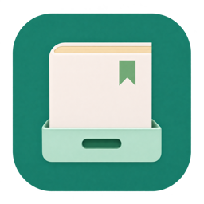
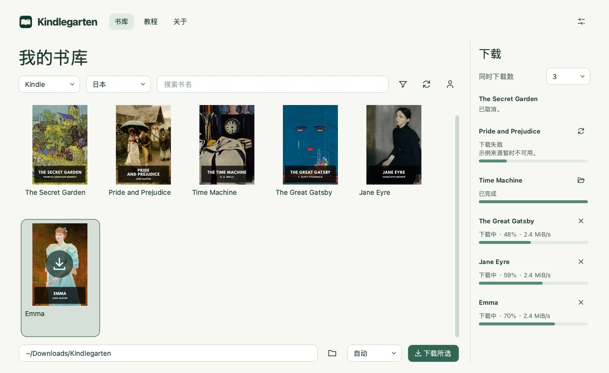

<p align="center">
  
</p>

<h1 align="center">Kindlegarten</h1>

<p align="center"><strong>备份已购电子书和漫画的桌面应用与命令行工具。</strong></p>

<p align="center">
  <a href="https://github.com/yinyanfr/kindlegarten/releases"></a>
  <a href="https://pypi.org/project/kindlegarten/"></a>
  <a href="DESKTOP_BUILD.md"></a>
  <a href="#桌面应用"></a>
  <a href="https://github.com/yinyanfr/kindlegarten/actions/workflows/publish.yml"></a>
  <a href="LICENSE"></a>
</p>

<p align="center">
  <a href="QUICKSTART.zh-CN.md">CLI 快速入门</a> ·
  <a href="#安装">安装说明</a> ·
  <a href="CHANGELOG.md">更新日志</a> ·
  <a href="README.md">English</a>
</p>

> [!TIP]
> **使用范围**
>
> 本项目仅用于备份本人在 Amazon 合法购买的 Kindle 电子书，以及在 Comipo 或 DLsite 合法购买的电子书和漫画。

备份已购的 Kindle 电子书，以及可通过 DLsite Play 阅读的电子书和漫画，包括受支持的 Comipo 购买内容。下载 Kindle 电子书时使用 Kindle for iPad 版本，保留亚马逊为该版本提供的彩色插图。

- 自动选择输出格式。文字书导出 EPUB，可提取为整页图片的固定版式漫画和杂志导出 CBZ。
- 按书名保存，自动处理文件名中的禁用字符和过长书名。CLI 用一条进度条显示整本书的下载进度。
- 按 Kindle 站点分别保存本机登录状态。

下载系列时，程序会按卷序将已购卷册保存到以系列名命名的文件夹。

## 桌面应用

<p align="center">
  <picture>
    <source media="(prefers-color-scheme: dark)" srcset="docs/media/bookshelf-zh-dark.webp">
    
  </picture>
  <br>
  <sub>示例书库，封面来自 <a href="https://standardebooks.org/ebooks">Standard Ebooks</a>。</sub>
</p>

从 [GitHub Releases](https://github.com/yinyanfr/kindlegarten/releases) 获取 macOS Apple Silicon 应用、Windows x64 便携 ZIP 或 Linux x86_64 AppImage，也可通过 Python 安装和启动桌面应用。

```sh
python -m pip install 'kindlegarten[gui]'
kindlegarten-gui
```

平台要求和自行编译的步骤见[桌面构建说明](DESKTOP_BUILD.md)。转换 Kindle 电子书使用本机安装的 Calibre。

在书库选择 **Kindle** 或 **DLsite**。Kindle 可选择站点。书架中央的「登录」按钮和书库右上角的账号图标都会打开对应的账号设置，可登录、重新授权、粘贴凭证或退出。

书库会先显示本机缓存，再在后台检查更新。点击搜索框旁的筛选图标，可按名称或购买时间对系列和单本混排。默认按购买时间从新到旧，系列使用最近购买的一卷的时间。

### 下载队列

先选好保存目录和文件格式。鼠标移到封面上后，点击中央图标可下载单本或打开系列。右键点击卡片，可下载书目或打开商店页面，系列还有「打开」选项。点击卡片其他位置可选中书目。按住 Command（macOS）或 Ctrl（Windows、Linux）可逐项多选，按住 Shift 可连续选择。点击「下载所选」后，按钮会在任务入队期间转圈。

任务入队后，右侧下载栏会自动展开。也可用应用右上角的下载图标显示或收起。点击下载栏上的加号，选择来源和 Kindle 站点，每行输入一个书籍或系列 ID。如果一个 ID 同时对应单本和系列，可用 `work:` 或 `series:` 指定。下载栏显示可获取的进度和速度，可选择同时下载 1 到 10 个任务，默认 3 个。

- **叉号**取消等待中或下载中的任务，已经保存的文件会保留。
- **环形箭头**以原来的保存目录和格式重试失败任务，并将它排到队尾。重试系列时会跳过已经按指定格式保存的卷册。
- **文件夹**在任务完成后打开保存位置。

从系列页下载单卷与下载整套使用同一个系列文件夹。封面右下角的对钩表示单本或全部已购卷已下载，数字表示系列已下载部分卷册。应用扫描当前保存目录，只统计系列文件夹里的卷册。从另一台设备复制的文件也可通过文件内 ID 或唯一匹配的标准文件名识别。

### 设置

点击右上角齿轮打开设置页。左栏分为「通用」「账号」「下载」「网络」「教程」「关于与更新」。「通用」可即时切换简体中文、English、日本語，以及浅色、深色和跟随系统的外观。「账号」可分别管理各 Kindle 站点和 DLsite 登录状态。左上角返回按钮可回到当前书库，并保留筛选和选中项。

「下载」中的 Calibre 路径留空时，程序会读取 `KINDLE_CALIBRE_BIN` 或自动查找。可在这里重新开启 Calibre 启动提醒。「去除 Kindle DRM」默认开启，关闭后直接保存 Kindle 原始 KFX 归档，无需 Calibre。

## CLI 书库与格式

```sh
kindlegarten help
kindlegarten help series
kindlegarten library
kindlegarten library --source dlsite
kindlegarten library --source amazon --region us
kindlegarten series SERIES_ID --source amazon --region jp --format epub --output ./books
kindlegarten work BJ123456 --source dlsite --format pdf
```

`library` 按可核实系列列出已购书籍，显示系列和书籍 ID，默认使用 Kindle 日本站。`work` 和 `series` 默认使用 DLsite。用 `--source amazon` 可切换到 Kindle。旧参数 `--source comipo` 是 `dlsite` 的别名。

桌面应用与 `download`、`work` 和 `series` 使用相同的导出格式。

| 内容 | 自动选择 | 可选格式 |
| --- | --- | --- |
| 文字电子书 | EPUB | EPUB 或使用 Calibre 转 PDF |
| 纯图片漫画或杂志 | CBZ | CBZ、ZIP、固定版式 EPUB 或 PDF |
| 仅提供 PDF 的书籍 | PDF | PDF |

CLI 使用 `--format auto|epub|pdf|cbz|zip` 指定格式。下载单本时，如果省略 `--format`，可由 `--output` 的文件扩展名推断格式。显式格式须与扩展名一致。下载系列时，`--output` 指定系列文件夹的上级目录。CBZ 和 ZIP 使用相同的漫画页图归档。

CLI 跟随系统语言，找不到对应语言时使用英语。可将 `KINDLEGARTEN_LANGUAGE` 设为 `en`、`zh` 或 `ja`。

## 安装

需要 Python 3.11 或更新版。登录 Amazon 需要浏览器，转换 Kindle 电子书需要 [Calibre](https://calibre-ebook.com/download)。命令面向 macOS、Windows 和 Linux，已在 macOS 实机验证。

```sh
python3 -m pip install kindlegarten
kindlegarten --version
```

Windows 可用 `py -3 -m pip install kindlegarten`。若系统的 Python 由包管理器维护，可在虚拟环境中运行 `pip install kindlegarten`，或用 `pipx install kindlegarten` 安装命令。安装、登录和下载第一本书的完整步骤见 [CLI 快速入门](QUICKSTART.zh-CN.md)。

## 登录方式

直接运行 `kindlegarten login` 会登录 Amazon 日本站。Kindlegarten 为各服务和 Kindle 站点使用独立的浏览器配置，后续登录可以复用浏览器会话。

| 服务 | 省略 `--method` 时 | 可选方式 |
| --- | --- | --- |
| Amazon Kindle | 打开浏览器并自动接收授权跳转。 | `browser` 使用默认流程。 `callback` 打印登录链接，由用户把最终跳转网址粘贴回终端。 |
| DLsite（`--source dlsite`） | 用 Playwright 打开浏览器并验证 Play 会话。 | `browser` 使用默认流程。 `cookie` 接受 DLsite Play Cookie 或会话 JSON。 `credentials` 在官方表单可用时使用无头 Chromium。 |

运行 `kindlegarten login --help` 可查看所有选项。

## Amazon Kindle

如需转换 Kindle 电子书，先安装 Calibre，再运行一次 `kindlegarten setup`。

```sh
kindlegarten login --region jp
kindlegarten d B0EXAMPLE0
```

登录后，程序会注册一个 Kindle for iPad 客户端。通过 SSH 使用时，加上 `--method callback` 打印登录链接，在另一台设备打开，再把最终跳转网址粘贴回远程终端。粘贴内容不会回显。

```sh
kindlegarten login --region jp --method browser
kindlegarten login --region jp --method callback
```

浏览器模式使用 Chrome 或 Playwright 的 Chromium。如果两者都没有，可在 CLI 的 Python 环境中运行 `python -m playwright install chromium`。

`d` 是 `download` 的简写，支持相同的参数。把示例中的 `B0EXAMPLE0` 替换为书籍的十位 ASIN。也可直接传入商品链接，程序会根据域名选择站点。单独输入 ASIN 时默认使用日本站。登录、查看其他站点的书库，或按 ASIN 下载时可加上 `--region`。可选 `jp`、`us`、`uk`、`de`、`fr`、`it`、`es`、`nl`、`ca`、`au`、`in`、`br` 和 `mx`。

```sh
kindlegarten download "https://www.amazon.co.jp/dp/B0EXAMPLE0"
kindlegarten download B0EXAMPLE0 --output "My Book.epub"
kindlegarten download --help
```

在 `setup`、`download`、`work` 或 `series` 后加 `--calibre-path PATH` 可指定 Calibre。路径可指向可执行文件目录、可执行文件或 macOS 的 `calibre.app`。省略参数时，优先读取 `KINDLE_CALIBRE_BIN`，未设置该变量时再自动查找。

Kindle 转换默认开启 `--dedrm`。使用 `--no-dedrm` 和 Auto 格式可保留原始归档，自定义输出文件名须以 `.kfx-zip` 结尾。登录和下载原始 Kindle 文件无需 Calibre。

```sh
kindlegarten d B0EXAMPLE0 --no-dedrm --output "My Book.kfx-zip"
kindlegarten s SERIES_ID --source amazon --region jp --no-dedrm --output ./books
```

默认输出到当前目录下的 `books/<书名>.epub` 或 `books/<书名>.cbz`，缺少可用书名时使用 ASIN。`--output` 可以指定文件名和格式，相对路径以当前目录为准。指定 CBZ 时，程序会检查页面能否安全地作为纯图片导出。已有同名文件会提示冲突。

## DLsite Play 与 Comipo 兼容

使用购买作品时的 viviON ID 登录 DLsite Play。旧 `--source comipo` 参数、Comipo 商品和 Play 链接以及原有作品 ID 仍可使用。CLI 的 `[comipo]` 安装额外选项也继续可用。

```sh
python -m pip install 'kindlegarten[dlsite]'
kindlegarten login --source dlsite
kindlegarten library --source dlsite
kindlegarten work BJ123456 --source dlsite
kindlegarten series SERIES_ID --source dlsite
```

用 `library` 显示的作品或系列 ID 替换示例。单本保存到 `books/`，系列保存到以系列名命名的子目录。可用 `w`、`s` 简写。手动登录时，使用 `kindlegarten login --source dlsite --method cookie` 并粘贴发往 `play.dlsite.com` 的 `/api/authorize` 请求中的 Cookie，或用 `--session-file` 导入 DLsite 会话文件。

升级前仅登录过 Comipo 的用户，需要用同一 viviON ID 登录 DLsite。若 DLsite 书库缺少旧 Comipo 购买记录，可在「设置 → 账号 → DLsite」检查并启用兼容。CLI 可在 `library`、`download`、`work` 或 `series` 加上 `--legacy-comipo`。兼容模式须验证两份本机会话属于同一 viviON ID，已从 DLsite 读取的作品优先。旧 Comipo Cookie 只用于 Comipo 域名。退出 DLsite 会清除这两份本地会话。

## 桌面应用更新

在「设置 → 关于与更新」点击「检查更新」。应用通过已配置的代理查询稳定版本和下载对应平台的更新包，并校验文件大小及 SHA-256。符合条件的 Windows 便携版、Linux AppImage 和满足系统签名要求的 macOS 应用可点击「更新并重启」。应用会等待当前书籍下载结束。新版启动失败时会尝试恢复原安装。

安装位置不可写或系统要求手动替换时，点击「显示已下载的更新包」。文件保存在系统下载目录下的 `Kindlegarten updates` 文件夹。通过 pip 安装的用户可运行 `python -m pip install --upgrade kindlegarten` 更新 CLI，或运行 `python -m pip install --upgrade "kindlegarten[gui]"` 更新桌面应用。

## 代理设置

在桌面应用的「设置」中可以选择系统代理、直连或自定义代理。CLI 通过 `KINDLEGARTEN_PROXY` 设置代理，可填 `system`（默认）、`direct` 或 HTTP、HTTPS、SOCKS5 代理地址，例如 `http://127.0.0.1:7890`。

## 发布新版本

在 `kindlegarten/__init__.py` 更新 `__version__`，并在 `CHANGELOG.md` 添加同版本的 `## X.Y.Z` 小节。推送到 `main` 会触发测试与三平台桌面构建。桌面构建通过后，工作流会通过 PyPI Trusted Publishing 发布 Python 包，并把桌面包附到 GitHub Release。若创建版本标签后发布失败，重跑该标签所指向提交的工作流。

## 本地数据

桌面应用和通过 pip 安装的 CLI 共用每个用户的数据目录，存放登录状态和导出依赖。桌面应用也会按服务或 Kindle 站点保存书库缓存，并缓存封面。

- macOS 使用 `~/Library/Application Support/kindlegarten/`。
- Windows 使用 `%LOCALAPPDATA%\kindlegarten\`。
- Linux 使用 `$XDG_DATA_HOME/kindlegarten/`，其默认值为 `~/.local/share/kindlegarten/`。

可以用 `KINDLEGARTEN_DATA_DIR` 指定其他目录。如果之前用源码运行过，可将它设为原仓库中 `.kindle-data/` 的绝对路径，以复用现有登录状态和依赖。直接在源码仓库运行 `python3 kindle.py` 也可继续使用仓库内的 `.kindle-data/` 和 `books/`。

## 排查问题

- **找不到 Calibre**。首次提醒可以关闭，也可以从提醒直接打开「设置 → 下载」。CLI 会打印官网下载链接。可在设置里填路径，运行时加 `--calibre-path`，或设置 `KINDLE_CALIBRE_BIN`。
- **Amazon 登录失效或需要切换账户**。运行 `kindlegarten logout --region jp` 清除日本站的本地登录状态，再重新登录。可在 Amazon 的「管理内容和设备」页面注销已注册的设备。
- **DLsite 拒绝会话**。重新登录 DLsite 或导入新会话。只有旧 Comipo 会话时，用同一个 viviON ID 登录 DLsite。
- **某本书无法下载或转换**。先确认该书能从对应站点的 Kindle 书库打开。格式和加密兼容性取决于 Amazon 针对该书下发的资源。
- **在另一台电脑下载 Kindle 电子书**。安装 Calibre 和 kindlegarten 后，运行 `kindlegarten setup` 安装导出依赖。

程序使用 [kindl](https://github.com/bGFiMTI2/kindl) 下载、[DeDRM Tools](https://github.com/Satsuoni/DeDRM_tools) 解密、[KFX Input](https://www.mobileread.com/forums/showthread.php?t=291290) 转档。项目采用 [MIT 许可证](https://github.com/yinyanfr/kindlegarten/blob/main/LICENSE)。
